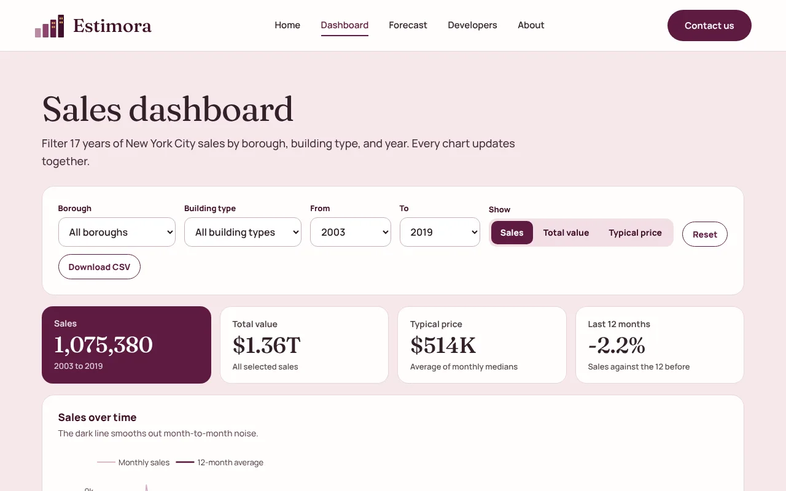
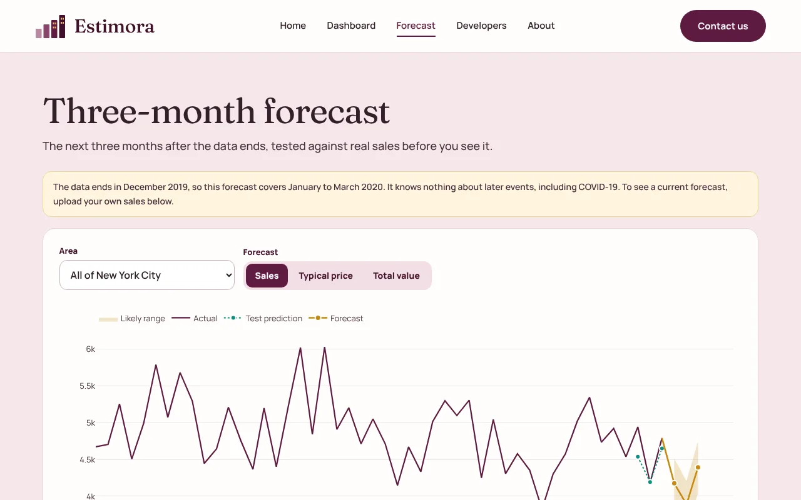

# Estimora

**Live site: [estimora-analytics.vercel.app](https://estimora-analytics.vercel.app)**

A sales dashboard and three-month forecast built on 1,075,380 cleaned New York City property sales. Built by Nimra Imran, AI Engineer.


## What it does

- **Explore:** filter 17 years of sales by borough, building type, and year.
- **Forecast:** see the next three months with a likely range, for sales, typical price, and total value.
- **Decide:** each borough's forecast becomes one plain recommendation.
- **Use your data:** upload a CSV and get your own three-month forecast.

| Dashboard | Forecast |
| --- | --- |
|  |  |

## How it works

```text
Python pipeline (offline)
  raw sales -> clean -> aggregate -> backtest models -> JSON
                        |
Next.js API routes on Vercel
  validate -> filter -> cache
                        |
React and Plotly interface
```

The 1.6 million source rows are reduced offline, so every API response reads small JSON files. This keeps the app fast on a serverless free tier.

## Data cleaning

| Step | Rows |
| --- | ---: |
| Source records | 1,600,162 |
| Exact repeats removed | -35,598 |
| $0 records removed | -463,013 |
| Below $10,000 removed | -26,171 |
| **Sales used** | **1,075,380** |

## Model testing

Seasonal naive, Holt-Winters, and SARIMA compete for each of 18 series: 6 areas and 3 targets. Each model runs through 8 rolling three-month windows. The first 7 windows choose the model, and the last window (October to December 2019) stays unseen as the reported test.

Citywide test error (MAPE, lower is better):

| Target | Seasonal naive | Holt-Winters | SARIMA | Chosen |
| --- | ---: | ---: | ---: | --- |
| Number of sales | 3.16% | 3.59% | 3.82% | SARIMA |
| Typical price | 5.51% | 3.20% | 2.31% | Holt-Winters |
| Total value | 11.12% | 11.30% | 16.87% | SARIMA |

The chosen model isn't always the winner of the final test, because it was picked before that test was seen. Total value is noisy because a few very large deals move it.

## API

| Method | Route | Purpose |
| --- | --- | --- |
| GET | `/api/health` | Service status and data range |
| GET | `/api/summary` | Cleaning report and headline numbers |
| GET | `/api/sales` | Monthly sales with filters |
| GET | `/api/compare` | Yearly series by borough or building type |
| GET | `/api/neighborhoods` | Busiest neighborhoods |
| GET | `/api/forecast` | History, test results, and forecast |
| POST | `/api/forecast/upload` | Forecast an uploaded CSV up to 4 MB |
| POST | `/api/contact` | Send a contact form message by Gmail |

Full details are on the [developer page](https://estimora-analytics.vercel.app/developers).

## Run locally

```bash
npm install
npm run dev
npm test
```

To enable the contact form, copy `.env.example` to `.env.local` and set `GMAIL_USER` and a 16-character Google App Password in `GMAIL_APP_PASSWORD`.

## Rebuild the data

```bash
pip install -r pipeline/requirements.txt
python pipeline/build_data.py <folder-of-sales-parquet>
```

## Tech stack

Next.js, React, TypeScript, Plotly, Python, pandas, statsmodels, Vitest, GitHub Actions, Vercel.

## Limits

The data covers January 2003 to December 2019, from a public cleaned copy of New York City Department of Finance files, so the bundled forecast covers January to March 2020 and knows nothing about later events. Forecasts are estimates, not financial advice. Estimora is an independent portfolio project and isn't affiliated with New York City.
